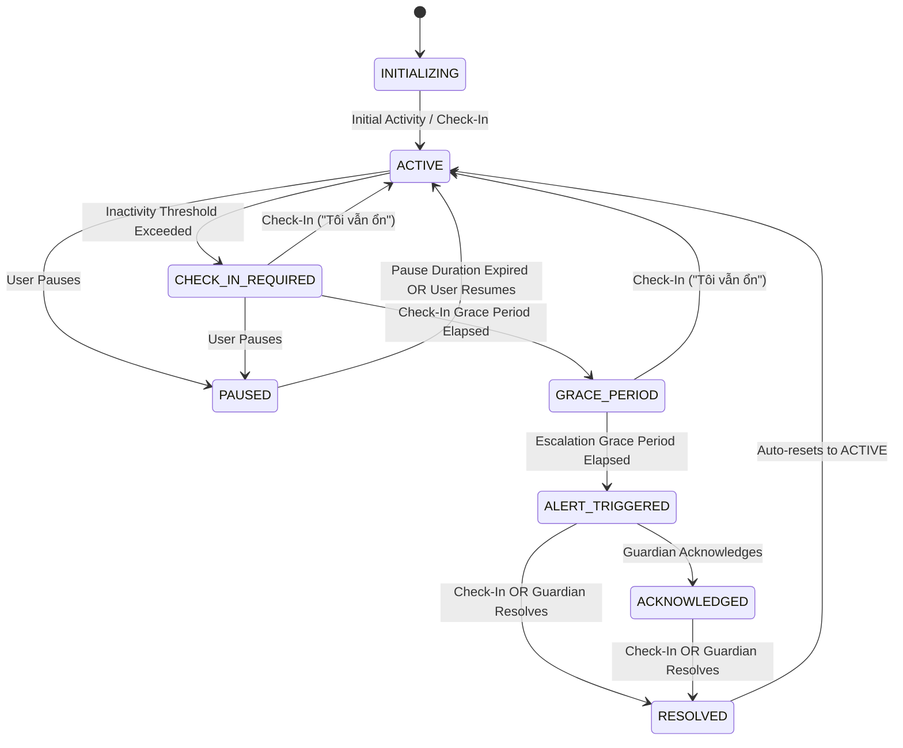

# Carely Monitoring State Machine Specification

## 1. Overview & States

The monitoring state machine regulates the authoritative lifecycle of a monitoring relationship. All transitions occur on the central server and are recorded in `monitoring_configs` and `audit_logs`.

### 1.1 State Dictionary

| State | Neutral Label | Meaning & Server Action |
| :--- | :--- | :--- |
| `INITIALIZING` | Thiết lập ban đầu | Configuration created, awaiting initial baseline activity. |
| `ACTIVE` | Đang hoạt động | Regular activity or check-in detected within configured threshold. |
| `CHECK_IN_REQUIRED` | Đang chờ xác nhận | Inactivity threshold exceeded. Push sent asking: "Bạn vẫn ổn chứ?". |
| `GRACE_PERIOD` | Cần kiểm tra | Check-in grace window expiring. Gentle high-priority reminder sent. |
| `ALERT_TRIGGERED` | Đã thông báo người thân | Escalation window expired. Incident created, guardians notified. |
| `ACKNOWLEDGED` | Người thân đã tiếp nhận| Guardian acknowledged receipt ("Xác nhận đã liên hệ"). |
| `RESOLVED` | Đã giải quyết | Incident closed via Check-in or guardian resolution. Returns to `ACTIVE`. |
| `PAUSED` | Đang tạm dừng | Monitored user temporarily suspended monitoring for privacy/rest. |

---

## 2. Mermaid State Transition Diagram



---

## 3. Authoritative Clock & Evaluation Timing

The server scheduler computes the next evaluation moment (`next_evaluation_at`) dynamically based on:
1. **Schedule Windows**: Active monitoring hours (e.g., 07:00 to 22:00) evaluated in the user's localized timezone (`date-fns-tz`).
2. **Overnight Windows**: For shifts or windows spanning midnight (e.g., 22:00 to 06:00), the scheduler evaluates:
   ```typescript
   if (startMinutes > endMinutes) {
     return currentMinutes >= startMinutes || currentMinutes <= endMinutes;
   }
   ```
3. **Inactivity Timing**:
   * If current state is `ACTIVE`:
     `next_evaluation_at = lastMeaningfulActivityAt + inactivityThresholdMinutes`
   * If current state is `CHECK_IN_REQUIRED`:
     `next_evaluation_at = checkInRequestedAt + checkInGracePeriodMinutes`
   * If current state is `GRACE_PERIOD`:
     `next_evaluation_at = gracePeriodStartedAt + escalationGracePeriodMinutes`

---

## 4. Invariants & Transition Guarantees

1. **Heartbeat Invariant**:
   A `HEARTBEAT` payload has weight `0.0`. It **NEVER** transitions `CHECK_IN_REQUIRED` or `GRACE_PERIOD` back to `ACTIVE`.
2. **Check-In Sovereignty**:
   A valid `CHECK_IN` payload ("Tôi vẫn ổn") has weight `1.0`. It **UNCONDITIONALLY** returns any state (`CHECK_IN_REQUIRED`, `GRACE_PERIOD`, `ALERT_TRIGGERED`, `ACKNOWLEDGED`) back to `ACTIVE` and auto-resolves any active incident for that relationship.
3. **Audit Immutability**:
   Every state change records an entry in `incident_events` or `audit_logs` capturing the previous state, new state, trigger event, and server timestamp.

---

## 5. Non-Diagnostic Composite Risk Scoring (0–100)

When an incident is created upon entering `ALERT_TRIGGERED`, Carely computes a **Composite Risk Score (0–100)** to prioritize alerts for guardians.

> **IMPORTANT**: The risk score is an operational heuristic for urgency prioritization. It makes **NO medical, diagnostic, or clinical claims**.

### Score Formula:
$$\text{RiskScore} = \min(100, \text{Base} + S_{\text{time}} + S_{\text{battery}} + S_{\text{historical}} + S_{\text{window}})$$

* **Base Score**: 40 points upon missing check-in.
* **Inactivity Factor ($S_{\text{time}}$)**:
  * $+5$ points for every additional 2 hours of inactivity past threshold (max $+25$).
* **Critical Battery Factor ($S_{\text{battery}}$)**:
  * Battery $< 15\%$ and not charging: $+20$ points (device likely depleted shortly after activity stopped).
  * Battery $< 5\%$: $+30$ points.
* **Historical Response Delay ($S_{\text{historical}}$)**:
  * User normally responds within 5 minutes, but 45 minutes elapsed: $+15$ points.
* **Off-Schedule Silence ($S_{\text{window}}$)**:
  * Inactivity during scheduled wake hours: $+10$ points.
