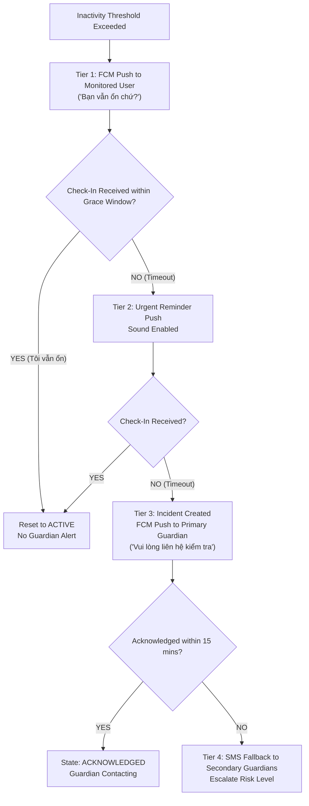

# Carely Notification & Alert Escalation Strategy

## 1. Principles of Reassuring UX Copy

Safety applications frequently cause unnecessary panic when alerts use hyperbolic language. False alarms are common when someone takes an unexpected nap, forgets their phone in another room, or attends a long cinema screening.

### 1.1 Copywriting Guidelines
* **Calm & Objective**: Describe observable system facts (e.g. "Chưa ghi nhận hoạt động", "Chưa nhận được phản hồi").
* **No Medical or Fatalistic Claims**: Never use phrases like `"có thể đã chết"`, `"nguy kịch"`, `"hôn mê"`, or `"tai nạn nghiêm trọng"`.
* **Action-Oriented Reassurance**: Always provide an immediate clear action: `"Bấm xác nhận Tôi vẫn ổn"`, `"Gọi điện kiểm tra"`.

---

## 2. Notification Copy Catalog (Vietnamese)

| State / Stage | Target Recipient | Channel | Title | Body Copy |
| :--- | :--- | :--- | :--- | :--- |
| **Check-In Request** | Monitored User | FCM Push | Bạn vẫn ổn chứ? | Đã khá lâu chưa thấy bạn dùng điện thoại. Chạm vào đây để xác nhận bạn vẫn ổn nhé. |
| **Grace Period Alert** | Monitored User | FCM High-Priority | Carely: Cần xác nhận hoạt động | Vui lòng bấm "Tôi vẫn ổn" để người thân yên tâm nhé. |
| **Alert Triggered** | Guardian (Monitor) | FCM Push | Thông báo từ Carely | Không nhận được xác nhận hoạt động từ {{name}} trong thời gian qua. Vui lòng liên hệ để kiểm tra. |
| **Escalated SMS** | Guardian (Monitor) | SMS Fallback | Carely Canh Bao | Carely khong nhan duoc phan hoi tu {{name}}. Xin hay goi dien kiem tra tinh hinh. |
| **Check-In Resolved** | Guardian (Monitor) | FCM Push | Người thân đã an toàn | {{name}} vừa gửi xác nhận "Tôi vẫn ổn". Sự cố đã được đóng. |

---

## 3. Multi-Tier Escalation Tree

---

## 4. Delivery Tracking & Retry Strategy

All outbound alerts are routed through the `NotificationsService` and tracked in `notification_deliveries`:
* **Exponential Backoff**: If FCM returns an ephemeral network error (e.g., `503 Service Unavailable`), the system retries at intervals of:
  $$T_{\text{retry}} = \min(300, 2^{\text{attempt}} \times 2) + \text{jitter}$$
* **Dead Lettering**: If a recipient's FCM token returns `messaging/registration-token-not-registered`, the device token is deactivated in `devices` and the message cascades immediately to SMS.
* **Audit Trail**: Every send attempt, success, or terminal failure updates `status` (`PENDING`, `SENT`, `DELIVERED`, `FAILED`) and timestamps in PostgreSQL.
